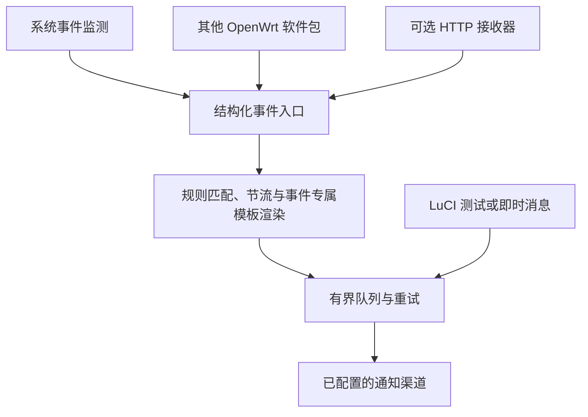

# CatOS Notify — 产品需求规格（v2，硬切版）

状态：2026-11-16 需求变更实施基线。尚未对外正式发布，已确认无需迁移/旧格式兼容；目标设备构建、安全审查和实机验收仍需完成。

## 1. 产品定位

CatOS Notify 是面向 OpenWrt 的轻量通知中心，以独立的 `catos-notify` 核心包和可选的 `luci-app-catos-notify` 管理界面提供以下能力：

- 统一接收本机系统事件、其他软件包的结构化事件及用户主动提交的消息。
- 根据规则匹配、去重、冷却时间和事件专属模板，将消息投递至一个或多个通知渠道或分组。
- 在 LuCI 中分别管理通知渠道、投递分组、事件规则及其专属模板、设备关注列表、接收器、安全设置和投递记录。
- 尽量复用 OpenWrt 原生事件、ubus、UCI、procd 和常用轻量组件；核心包不依赖 LuCI。

核心包与 DDNS、ACME 等功能包独立安装、独立升级。其他软件包只负责产生自己的业务事件，通过标准本机接口交由 Notify 路由，不在 Notify 中重复实现它们的业务逻辑。

## 2. 消息与事件流程

### 2.1 消息类型

1. **即时消息**：调用者提供标题、正文、级别及明确的目标渠道/分组引用列表，无须绑定系统事件，不使用模板。
2. **结构化事件**：具有 `source`、`event`、`severity`、`timestamp`、`data` 的稳定字段；每条规则自己决定匹配条件、投递目标和专属标题/正文模板。

所有入口均须验证输入长度、类型及允许的目标范围。事件字段不得被当作 shell 命令执行。局域网和公网接收器不能提交任意外部 URL 供服务端转发。

## 3. 通知渠道

首版支持以下八类；可创建多个同类型实例。所有渠道至少支持启用/停用、名称、凭据、测试发送、超时、成功/失败反馈。渠道本身**不含分组字段**；投递分组维护成员列表，一个组可包含多个渠道，一个渠道可加入多个组。渠道和组通过稳定的具名 UCI section ID 引用，以免删除其他渠道导致下标漂移和错投。

| 渠道 | 配置与发送方式 | 首版范围 |
| --- | --- | --- |
| Bark | 服务端地址、Device Key，JSON `/push` | 标题、正文、基础优先级 |
| PushGo | 服务端地址、Channel ID 和密码/API 凭据 | 标题、正文、级别 |
| ntfy | 服务端、Topic、可选 Bearer 凭据 | 标题、正文、优先级 |
| 飞书 | 自定义机器人 Webhook、可选签名密钥 | 文本消息 |
| 钉钉 | 群机器人 Webhook、可选加签 | 文本消息；应用机器人另需特定应用凭据，不默认为兼容 |
| 企业微信 | 群机器人 Webhook Key | 文本消息 |
| Telegram | Bot Token、Chat ID | `sendMessage` 文本消息 |
| 通用 Webhook | 固定 HTTPS URL、预置授权头、JSON 请求体 | 可自定义固定接收端；不能由消息动态改写目标 |

目前不扩展邮件、短信、Discord 或其他渠道。服务端响应即使 HTTP 状态码为 200，也须检查渠道返回的业务错误码（适用时）。渠道凭据不写入投递日志。

## 4. 系统事件

首版最低覆盖以下事件。所有事件规则可独立配置启停、多个投递目标（渠道和/或分组）、专属消息模板及冷却时间；适用时支持筛选接口/设备。

| 事件 ID | 触发条件 | 重要行为与误报防护 |
| --- | --- | --- |
| `wan.down` | 受监控 WAN 从正常变为断开 | 状态变化去重；可能离线缓存 |
| `wan.up` | 受监控 WAN 从断开恢复 | 发送恢复和离线期间待发消息 |
| `wan.ipv4.changed` | WAN IPv4 地址增删/变化 | 明确旧值、新值和接口 |
| `wan.ipv6.changed` | WAN IPv6 地址增删/变化 | 排除无关临时地址抖动；支持独立通知 |
| `wan.prefix.changed` | IPv6 委派前缀变化 | 提供前缀及长度 |
| `public.ipv4.changed` | 外部探测到公网 IPv4 变化 | 不把 RFC1918/CGNAT 地址当公网地址 |
| `public.ipv6.changed` | 外部探测到公网 IPv6 变化 | 支持禁用外部探测和单独频率 |
| `wan.primary.changed` | 可唯一确定的默认主出口改变 | 多 WAN 负载分担无单主线时不虚报 |
| `device.unknown.online` | 未加入已知设备列表的新 MAC 被发现 | 首次发现与短期去重；不主动全网扫描 |
| `device.known.online` | 指定设备经连续探测判定上线 | 指定 MAC / IP，避免邻居缓存假上线 |
| `device.known.offline` | 指定设备经连续探测判定离线 | 防抖，暂时无法探测不立即告警 |
| `auth.ssh.failed` | SSH 连续登录失败达到次数阈值 | 时间窗口和来源信息（如可获取） |
| `auth.luci.failed` | LuCI 连续登录失败达到次数阈值 | 以系统实际日志为准；不记录密码 |
| `system.boot` | 路由器启动完成 | 每次系统启动仅触发一次 |
| `system.reboot` | 收到受控重启/关机流程的通知 | 关机时网络可能不可用，不承诺必达 |
| `health.cpu_temp.high` | CPU 温度高于配置阈值 | 回落前不持续重复报警 |
| `health.load.high` | 负载高于配置阈值 | 持续超阈值、冷却时间 |
| `health.memory.high` | 可用内存低于配置阈值 | 优先使用 `MemAvailable` |
| `health.storage.low` | 指定挂载点可用空间低于阈值 | 排除只读/特殊文件系统（可配置） |
| `system.summary` | 周期到达 | WAN、地址、运行时长、负载、内存与存储摘要 |

设计注意：IPv4/IPv6 地址与公网探测结果属于不同概念；WAN 物理/逻辑连接状态不同于公网可达性。基于邻居缓存或 DHCP 租约无法绝对证明设备在线；面向已知设备的离线告警应通过指定地址连续探测、确认后才发送。OpenWrt 发行版和登录组件存在日志格式差异，适配需实机验收。

## 5. 规则、事件专属模板与投递

- 同一事件可匹配多条已启用规则。每条规则可以同时选择多个具名渠道和投递分组，并设置级别、冷却时间和接口/设备筛选；不提供默认投递分组或默认目标。
- 每条规则直接拥有独立标题和正文模板；**不提供独立的模板管理页、共享模板 ID 或默认模板回退**。内置 20 类事件分别提供契合自身语义的初始模板，用户可独立编辑。
- 模板支持 `{{router}}`、`{{event}}`、`{{source}}`、`{{severity}}`、`{{time}}`、`{{body}}`、`{{interface}}`、`{{device}}`、`{{old}}`、`{{new}}` 及事件 `data` 中安全的平面键值；界面应按事件类型提示相关变量。
- 展开分组后，同一渠道即使被直接选择或命中多个分组，**同一条规则只入队一次**；不同规则可独立发送。删除目标后不得误投到其他渠道，悬空引用在界面中标注缺失。
- 空投递列表表示规则不发送，空分组表示不产生投递；不会自动退回任何分组。禁用渠道不收正常投递，但仍允许手动测试其已保存的凭据。
- 未知变量保持原样或按明确策略替换为空，不得解释成 shell/Lua/JavaScript 表达式。
- 提供“发送测试消息”并展示单渠道成功/失败结果，不必等待事件发生。
- 重复事件可去重、设置冷却期。投递使用有界队列、请求超时和有限重试；故障期间不无限占用磁盘、内存或网络连接。
- 历史至少可查看时间、事件、渠道、状态和不含敏感信息的错误原因，提供条数/时长上限。断电、离线等不承诺消息必达。
- 严重告警和普通摘要可以路由到不同的多个渠道分组，支持禁用某个渠道而不影响其他渠道。

## 6. 内部调用接口

核心包提供命令行及受 ACL 限制的 ubus/rpcd 接口，供无 LuCI 的路由器、DDNS、ACME 和其他软件包调用：

- `send`：提交即时消息，明确提供 `targets` 数组（`channel:<稳定ID>` 或 `group:<稳定ID>`），不可省略。
- `publish`：提交结构化事件，由规则决定分发。
- `test`：只针对已配置的渠道发送明确标记的测试消息。
- `status`：读取服务状态、队列信息及最近投递结果。

输入应统一为可校验的 JSON；无须调用者知道各渠道的协议或凭据。内部接口必须遵循 OpenWrt 的 ACL/文件权限，不默认向网络开放。

## 7. 可选 HTTP 接收器

接收器默认关闭，只有管理员主动开启才接受消息。LuCI 显示三个独立选项：

| 选项 | 行为 |
| --- | --- |
| 接收器开关 | 默认关闭；关闭时任何远程发送请求均拒绝 |
| 访问范围 | 默认“仅内网”；可改为“允许外网” |
| 强制授权 | 默认开启；内网模式允许管理员关闭；外网模式必须开启，不能绕过 |

安全要求：外网须通过 HTTPS、足够随机的 Token、请求体大小限制、固定消息目的地、请求频率限制及身份验证；拒绝使用查询字符串传 Token。系统不应自动开放 WAN 防火墙或将 LuCI 管理后台一并暴露在公网。接收器被关闭、凭据未配置、来源不允许或鉴权失败时返回可识别且不泄漏配置的错误。

## 8. LuCI 交互

1. **概览**：服务开关、运行状态、队列与最近发送、快捷测试。
2. **渠道**：添加/编辑/删除渠道，按类型展示必要配置项、启用和单渠道测试；不配置分组。
3. **投递分组**：独立增删改分组，并从已有渠道中选择一个或多个成员；可重用渠道。
4. **事件规则**：列表用可翻译的事件名称、具体投递目标、模板标题、节流状态等语义列，避免内部 ID 充当主要展示内容；编辑窗口可多选分组和渠道，并独立配置标题、正文、可用变量、过滤、等级与冷却期。
5. **已知设备**：登记 MAC、可选 IP、别名，指定上线/离线监测。
6. **接收器和设置**：启停、内网/外网范围、授权开关、凭据、节流、采样周期和阈值。
7. **历史记录**：按时间和结果查看投递状态，敏感信息隐藏。

核心包完全可通过 UCI/CLI 使用；LuCI 页面不得直接暴露任意命令执行能力。

## 9. 非功能与安全要求

- 默认不开启 HTTP 接收器、不主动开放端口、不改变原有防火墙和 WAN 路由。
- 在小内存 OpenWrt 设备上保持一个轻量常驻监测进程；禁止高频无界日志、缓存和轮询。
- 仅在配置变更、首次设备登记等必要场景写入持久存储；运行状态、队列和短期去重状态放在 tmpfs。
- 网络调用有显式连接超时和总超时，事件捕获不能被外部通知服务器阻塞。
- 凭据只对特权账号可读；日志、状态页、URL 和 API 响应不得回显密钥。
- 采用受限的 UCI 配置字段、固定渠道驱动和消息数据格式，不通过输入执行脚本。
- 24.10（opkg）与 25.12（apk）软件包能被 OpenWrt SDK 构建；不将构建通过等同于实机兼容。

## 10. 验收矩阵

| 编号 | 检查 | 验收标准 |
| --- | --- | --- |
| N-01 | 八类渠道 | 每类能新增配置实例并测试，成功与业务错误正确反馈 |
| N-02 | 事件专属模板 | 每条规则可独立修改标题/正文，变量正确渲染且不执行输入；无模板独立入口 |
| N-03 | 内部接口 | CLI、ubus 发送和第三方软件包 `publish` 走统一规则 |
| N-04 | WAN 地址/状态 | 断开、恢复、IPv4、IPv6、PD 切换仅在状态变更时通知 |
| N-05 | 公网地址及多 WAN | 外部 IPv4/IPv6 探测更新及真实主出口切换，不误报 |
| N-06 | 设备上线/离线 | 未知设备首次出现、指定设备上线/离线；重复租约和短暂丢包不过度通知 |
| N-07 | 登录失败 | SSH/LuCI 在配置窗口内达到阈值后告警，保留来源但不保留口令 |
| N-08 | 健康与摘要 | 启动、受控重启、温度、负载、内存、存储、定时摘要覆盖 |
| N-09 | 离线与限额 | 断网时有限排队并在恢复后重试；队列、速率、时长有上限 |
| N-10 | HTTP 接收器 | 默认关闭；仅内网来源验证；外网模式不能关闭鉴权；HTTP 明文外网拒绝 |
| N-11 | LuCI | 渠道/分组独立管理，规则多选目标、事件中文/英文说明与模板编辑能保存回显；敏感字段隐藏 |
| N-13 | 无隐式路由 | 新建渠道/规则无默认目标；空组、空目标均不发送；跨组重复渠道只入队一次 |
| N-14 | 目标引用安全 | 删除渠道不改变其他渠道的稳定 ID；悬空目标有提示、不误投；禁用渠道的手动测试不受开关限制 |
| N-12 | 平台 | SDK 编译、shell/JS 检查、目标设备事件注入与长期运行验证 |

## 11. 实施与发布说明

本规格是实现和测试的对照基线，不构成“所有功能已实机验证”的声明。渠道端点可能有服务商侧的限流和授权限制；WAN/mwan3、登录日志、设备在线探测须分别在具备相应组件的目标设备上验证。接收器外网暴露、凭据生命周期与安全测试应由独立审核者复核后再作为稳定版发布。

### 本次需求变更影响

- **已确定**：未公开发布，直接取消 `channel.group`、`rule.group`、`rule.template` 和 `config template`；不做迁移兼容。新格式使用 `config group` 的 `list channels` 和 `config rule` 的 `list targets`、`option title`、`option body`。
- **数据一致性风险**：分组/渠道引用必须使用稳定 ID；仅 LuCI 新建路径保证自动生成具名 ID。手工 UCI 配置也必须使用具名 section。
- **触达风险**：规则未选择任何目标时明确视为尚未配置，不产生隐式广播；同一规则内目标展开后按渠道 ID 去重。
- **需要设备验收**：原生 LuCI 表单多选控件的实际布局、保存和回显；RPC `send` 数组参数；消息队列投递、失败重试、中文和英文切换；安装完整 APK/IPK 构建产物。
